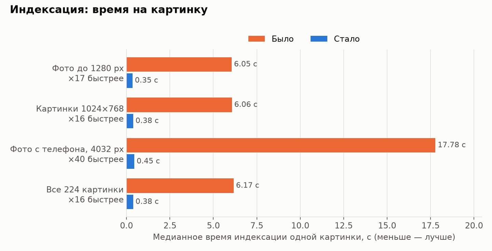
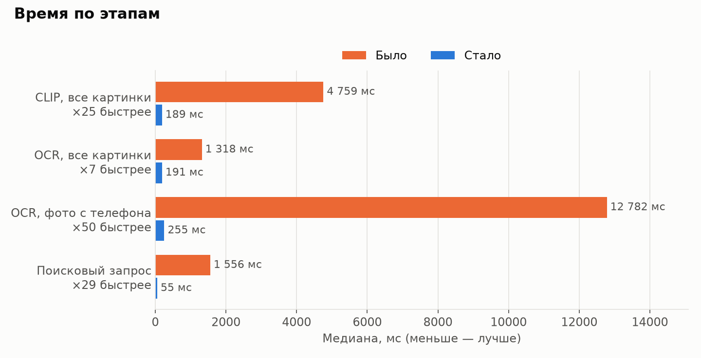
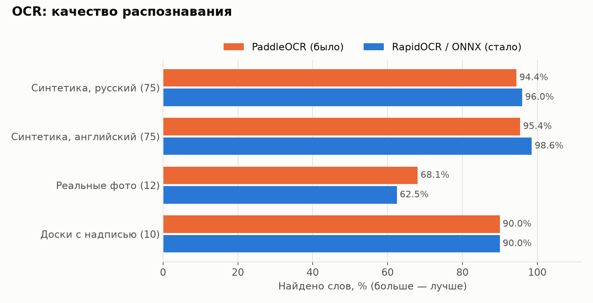

# Сквозной замер: torch + PaddleOCR → ONNX Runtime

Сколько времени уходит на индексацию одной картинки до и после перевода моделей на ONNX Runtime и не стало ли хуже качество. Всё на CPU (Ryzen 5 5600H, 6 ядер / 12 потоков, Windows 11), видеокарта не используется.

## Коротко

- Индексация **в 19 раз быстрее**: 224 картинки за 94 с вместо 1790 с (143 картинки в минуту вместо 8).
- Фото с телефона (4032 px): **в 40 раз быстрее**, 0,45 с вместо 17,8 с.
- Поисковый запрос: 55 мс вместо 1,5 с.
- Качество поиска по смыслу то же: векторы ONNX совпадают с исходной моделью (косинус 1,00000).
- Качество OCR: на синтетике лучше (русский 94,4% → 96,0% найденных слов, английский 95,4% → 98,6%, ошибок в символах 4,2% → 3,1%), на 12 реальных фото одно слово прочитано иначе (68,1% → 62,5%).
- Окружение бэкенда: 1,5 ГБ → 389 МБ, без torch и PaddlePaddle. Пик памяти 6,8 ГБ → 2,3 ГБ.

## Что поменялось

| | Было | Стало |
|---|---|---|
| Поиск по смыслу | open_clip + torch, `ViT-B-16-SigLIP2`, с `torch.amp.autocast("cpu")` | та же модель, ONNX-экспорт (`immich-app/ViT-B-16-SigLIP2__webli`) на ONNX Runtime |
| OCR | PaddleOCR 3.x на PaddlePaddle (CPU, без MKLDNN) | RapidOCR на ONNX Runtime, те же модели PP-OCRv5 mobile det + eslav mobile rec |
| Подготовка картинки для CLIP | полное декодирование | JPEG декодируется сразу уменьшенным (`Image.draft`), EXIF-поворот применяется |
| Картинка для OCR | исходный размер (до 4000 px) | уменьшается до 960 px по длинной стороне |

Главная причина медленного CLIP: `autocast("cpu")` переводил вычисления в bfloat16, который этот процессор не умеет считать аппаратно и эмулирует. Отдельная проверка на 6 картинках: 168 мс в fp32 против 1464 мс с autocast. В приложении CLIP шёл 4,8 с на картинку, хотя бенчмарк моделей (`bench/README.md`, без autocast) показывал 0,25 с.

## Скорость

Набор (`make-dataset`, 224 картинки):

- 42 картинки из `test-images`: фото до 1280 px и доски с надписью;
- 150 синтетических картинок 1024×768 из бенчмарка OCR (`bench/ocr/data/images`);
- 32 «фото с телефона»: фото из `test-images`, увеличенные до 4032 px. Пиксели у них ненастоящие, но время декодирования и детектора текста зависит от размера, а качество OCR меряется отдельно.

Для каждой картинки скрипт делает то же, что воркер: sha256, вектор CLIP, OCR.



| Группа | Было, с | Стало, с | Ускорение |
|---|---|---|---|
| Фото до 1280 px (42) | 6,05 | 0,35 | ×17 |
| Картинки 1024×768 (150) | 6,06 | 0,38 | ×16 |
| Фото с телефона 4032 px (32) | 17,78 | 0,45 | ×40 |
| Все (224), медиана | 6,17 | 0,38 | ×16 |
| Все (224), общее время | 1790 | 94 | ×19 |



| Этап | Было, мс | Стало, мс | Ускорение |
|---|---|---|---|
| CLIP, картинка | 4759 | 189 | ×25 |
| OCR, все картинки | 1318 | 191 | ×7 |
| OCR, фото с телефона | 12782 | 255 | ×50 |
| Поисковый запрос | 1556 | 55 | ×29 |
| Загрузка CLIP (картинки) | 8,6 с | 0,7 с | |
| Загрузка OCR | 4,4 с | 1,2 с | |

Числа — медианы. Подробные результаты по каждой картинке лежат в `results/baseline.json` и `results/onnx.json`, векторы — в `.npz`.

## Качество

### Поиск по смыслу (CLIP)

Модель та же, поменялась только среда выполнения, поэтому достаточно сравнить векторы:

| Проверка | Косинус между векторами |
|---|---|
| ONNX против open_clip fp32, 36 картинок | 1,00000 |
| ONNX против open_clip fp32, 18 запросов (ru/en, «ё», пунктуация, длинный запрос) | 1,00000 |
| ONNX с быстрым декодированием JPEG против open_clip fp32 | не ниже 0,99925 |
| ONNX против прежнего приложения (bf16), 224 картинки | медиана 0,99987, минимум 0,994 |

Токенизатор (Gemma, библиотека `tokenizers` без `transformers`) дал те же токены, что open_clip, на всех 18 запросах. Поэтому Recall@1 на XM3600 остаётся прежним: 0,767 (`bench/README.md`). Векторы совместимы со старыми, переиндексация не нужна.

### OCR

Бенчмарк `bench/ocr` (подробно в `bench/ocr/README.md`): доля слов из разметки, найденных в распознанном тексте. Именно так работает поиск `ocrQuery`.



| Метрика | PaddleOCR (было) | RapidOCR / ONNX (стало) |
|---|---|---|
| Синтетика, русский (75), найдено слов | 94,4% | **96,0%** |
| Синтетика, английский (75), найдено слов | 95,4% | **98,6%** |
| Реальные фото (12), найдено слов | **68,1%** | 62,5% |
| Доски с надписью (10), найдено слов | 90,0% | 90,0% |
| Ошибки в символах (CER), синтетика | 4,2% | **3,1%** |
| Лишние слова на фото без текста (10) | 2,3 | **1,9** |
| Время на картинку, мс (6 потоков) | 1812 | **193** |

Про реальные фото: из 12 фото разница в одном. Слово «ПРОДОВОЛЬСТВЕННЫЙ» распознано как «ПРОДОВОЛЬСТВЕННЫИ», и метрика, ищущая слово целиком, его не засчитывает. Поиск в приложении учитывает формы слова, так что эту картинку он находит. Выборка из 12 фото слишком мала, чтобы делать вывод об ухудшении. На 150 синтетических картинках качество выросло.

Как выбирались настройки RapidOCR (все варианты в `bench/ocr/results/raw_preds`):

| Вариант | Реальные фото | Синтетика ru | CER | мс |
|---|---|---|---|---|
| те же настройки, что у PaddleOCR | 62,5% | 94,7% | 3,9% | 220 |
| без расширения маски детектора | 61,1% | 98,4% | 1,8% | 223 |
| до 960 px | 61,1% | 95,1% | 3,8% | 182 |
| **до 960 px, без расширения маски (выбран)** | 62,5% | 96,0% | 3,1% | 193 |
| до 1280 px | 62,5% | 94,7% | 3,9% | 218 |

RapidOCR по умолчанию расширяет маску детектора (`use_dilation`), PaddleOCR этого не делает. Расширение склеивает соседние слова и портит русский текст, поэтому выключено.

## Ограничения

- Замер сделан на одной машине, один прогон, остальные программы не закрывались. Разброс между прогонами около 10% (два прогона ONNX: 85 и 94 с).
- «Фото с телефона» искусственные (увеличенные).
- Реальных фото с разметкой для OCR всего 12.
- Пик памяти считался в одном процессе, где загружены и текстовый, и визуальный энкодеры CLIP. В приложении воркер грузит только визуальный, API только текстовый.

## Как повторить

Из папки `backend` (нужны `test-images`, см. `backend/scripts/fetch_test_images.py`, и `bench/ocr/data/images`, см. `bench/ocr/make_dataset.py`):

```bash
uv run python scripts/bench_indexing.py make-dataset
uv run python scripts/bench_indexing.py run --label onnx      # ~1,5 мин
uv run python scripts/bench_indexing.py compare baseline onnx
```

Базовая линия (`baseline`) снята на коммите `35ce933` (до перевода на ONNX), прогон занимал 30 минут.

Качество OCR (из корня репозитория, ~1 мин на вариант):

```bash
python -m uv run --project backend --with rapidfuzz python bench/ocr/ocr_bench.py run --threads 6 --systems rapid-eslav-960-nodil
```

Графики:

```bash
python -m uv run --project backend --with matplotlib --with rapidfuzz python bench/e2e/make_figures.py
```
